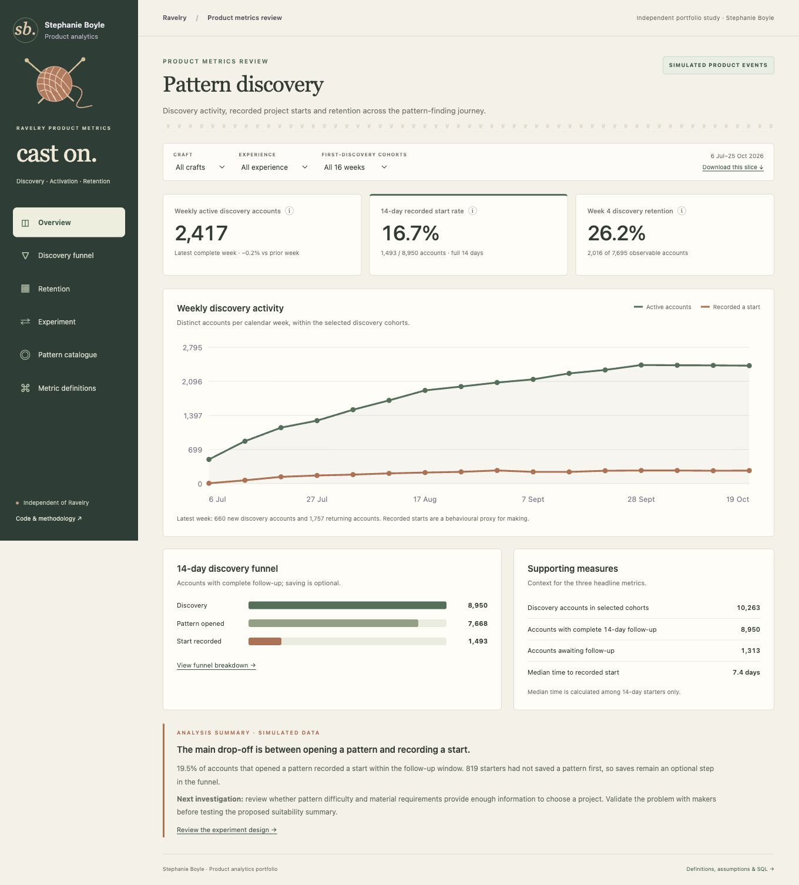

# Cast on
### Ravelry discovery, activation and retention

What happens between finding a pattern you like and actually starting it?

I used Ravelry as the setting for this project because that question has a few interesting layers. There is the maker trying to choose something they can make, the designer hoping their work gets found, and the product trying to help both of them. More browsing might be useful. It might also mean someone is stuck.

I wanted to work through that question in the way I would in a product team: define what useful looks like, understand the journey, check the data, and work out what evidence would change the decision.

**The main piece is an interactive product analytics app.** The Python, SQL and dbt sit underneath it, where you can inspect how the numbers were made.



## Have a look around

The app has six sections:

- **Overview:** three headline measures — weekly discovery activity, 14-day recorded-start rate and week-four retention — with a concise analysis summary.
- **Discovery funnel:** where the journey narrows, including people who start without saving a pattern first.
- **Retention:** weekly retention cohorts, with the numerator and denominator behind each cell. New cohorts stay unobserved until their follow-up window is complete.
- **Experiment:** a proposed improvement, an assumed-effect scenario, and a no-effect scenario. Both have the same decision rules.
- **Pattern catalogue:** context about recorded activity, designers and the evidence behind ratings.
- **Metric definitions:** metric definitions, assumptions, tracking choices and the actual SQL models.

You can filter the behavioural analysis by craft, experience and discovery cohort, inspect definitions, and download a metric slice.

## First, a word about the data

I don't have Ravelry's internal event data. I have kept three things separate:

| Data | What it is for |
|---|---|
| **Simulated product events** | Funnel, activation and retention analysis. Fictional accounts and behaviour, generated with a fixed seed and explicit assumptions. |
| **A separate simulated experiment** | Assignment, intention-to-treat analysis, power, uncertainty and guardrail decisions. |
| **Real Ravelry API data** | A bounded catalogue sample, adding context about patterns and designers. No claim to measure real impressions or product conversion. |

The app labels the source in each section. Differences in simulated craft or experience segments come from the assumptions I put in; they are not discoveries about Ravelry users. Real records and their derived app payload stay local, outside the repository. A clone works fully with the simulated data; the real catalogue section needs an authorised local snapshot.

## What I wanted to demonstrate

A start rate is only useful if I can explain who is in it. Here, the observational denominator is discovery accounts with a complete 14-day window. A newer account is not counted as a failure. The experiment uses its own assigned-account denominator, rather than selecting people who clicked.

Retention needs context too. People do not necessarily start a new craft project every week. I use a return to discovery as one signal of continued usefulness, while keeping it separate from recorded starts. Neither tells me directly how confident someone feels or whether they actually made something.

The working product idea is clearer suitability information within existing discovery. Before building that, I would check the current experience and watch people choose a project. The analysis should help me ask better questions; a funnel on its own cannot explain why someone leaves.

## Run the app

From this directory, with Python 3.10–3.12:

```sh
python3 -m venv .venv
source .venv/bin/activate
python -m pip install -r requirements.lock
python -m pip install --no-deps -e .
make app
```

Open [the local app](http://127.0.0.1:8765/). The committed aggregate export makes the simulated app usable immediately; there is no API key or JavaScript build step.

To rebuild the data and run the checks:

```sh
make app-data
make test
```

That regenerates fictional accounts and events, builds the product dbt models, reruns the experiment, and exports the app data. It also creates a portable, self-contained HTML app at `reports/private/product-metrics.html`, which can be opened directly in a browser without a running server.

For real catalogue collection, use your own read-only app credentials in an ignored `.env`, then run the small feasibility sample before expanding. The [access guide](docs/access_setup.md) and [feasibility notes](docs/data_feasibility.md) explain the steps and constraints. Existing snapshots can be used with `make model catalogue app-export`.

## If you want the detail

- [Product metrics and app methodology](docs/product_metrics.md)
- [Product recommendation](docs/product_recommendation.md) and [interview notes](docs/interview_notes.md)
- [Measurement framework](docs/measurement_framework.md), [tracking plan](docs/tracking_plan.md), [experiment design](docs/experiment_design.md)
- [Product SQL models](dbt_product/models), [catalogue SQL models](dbt/models), [Python](src/ravelry_analytics) and [tests](tests)
- [Generated experiment results](reports/synthetic/summary.md), [validation](docs/validation.md), [project status](PROJECT_STATUS.md)

This is an independent portfolio project, with no Ravelry affiliation and no confidential employer data. The repository is private. Data handling and publication constraints are in [the data notes](data/README.md).
