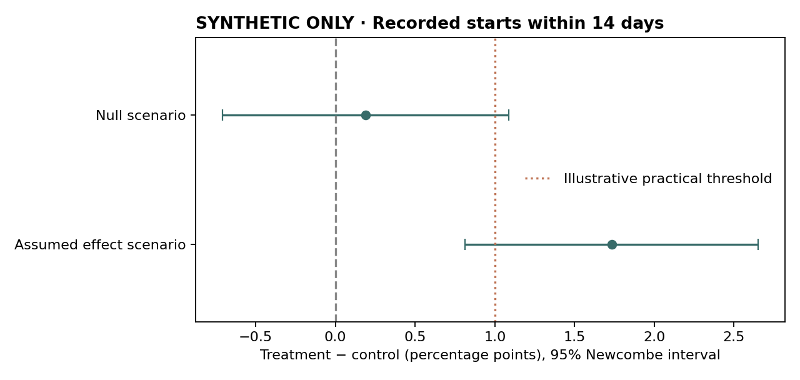

# Confidence to start
### A product decision, supported by catalogue diagnostics and an experiment design

**How could Ravelry help makers discover a pattern they feel confident starting, while supporting a healthy range of designers?**

Independent portfolio exercise; no affiliation with Ravelry. Built for private review. Real API data and real-data exports remain local and are excluded from Git, including this private repository. The supplied agreement restricts redistribution; private repository visibility does not override those terms.

## The decision

Investigate a concise, explainable suitability summary within existing discovery: why a pattern fits explicit preferences, what requirements remain unknown, and how much evidence supports its crowd ratings. Validate the need with makers before building. Existing official help already describes filters, comparison and stash suggestions, so this is an improvement hypothesis rather than a claim that suitable discovery is absent.

The [private real-data findings](reports/private/findings.md) answer four questions: activity concentration; age/craft context; availability of rating evidence; and whether an opportunity ranking is defensible. The conclusions are conditional on a bounded `cowl` search with unspecified ordering. They favour better uncertainty communication and additional research over an objective quality score. Full observed counts and three charts are in that local report, not embedded in the repository. A fresh clone must collect its own authorised snapshot to reproduce it; records and outputs can change.

## Real evidence versus simulated evidence

| Workstream | Source | What it supports |
|---|---|---|
| Catalogue diagnostics | Real read-only Ravelry API snapshot | Sample-specific activity, metadata and coverage observations; no impressions or causal effects |
| Experiment demonstration | Seeded synthetic users and events in a separate directory | Statistical workflow and decision logic; no evidence that the feature works on Ravelry |

Primary experiment outcome: proportion of assigned eligible accounts recording a new in-progress project within 14 days. This is an imperfect proxy for actually starting. Keep recording affordances identical and validate behaviour through research. Designer exposure and popularity concentration need internal impression instrumentation, unavailable in this catalogue study.

In the **synthetic effect scenario**, the estimated difference is **1.73 percentage points** (95% CI 0.81 to 2.65); it meets the predefined illustrative primary and abandonment criteria. The **synthetic null scenario** gives 0.19 points (95% CI -0.71 to 1.09) and does not meet them. Read the [generated results](reports/synthetic/summary.md), [machine-readable output](reports/synthetic/results.json) and [protocol](docs/experiment_design.md). Other proposed guardrails are not simulated, so these are not full launch criteria.



## Reproduce locally

Python 3.10–3.12 recommended; validated on Python 3.10, macOS ARM64. `requirements.lock` freezes the tested environment; other platforms may need a compatible fresh resolution from pyproject.toml.

```sh
python3 -m venv .venv
source .venv/bin/activate
python -m pip install -r requirements.lock
python -m pip install --no-deps -e .
make offline
```

That reproduces both labelled synthetic scenarios, analysis, null calibration and Python checks **without API credentials**. It does not create a synthetic Ravelry catalogue.

For the real-data pipeline, obtain app-issued **read-only Basic Auth** credentials through Ravelry's free Pro developer registration. Review the applicable agreement; see [feasibility](docs/data_feasibility.md). Configure locally:

```sh
cp .env.example .env
chmod 600 .env
# Edit .env privately. Never put credentials in a command or commit them.
make collect
make model
make catalogue
```

`make collect` makes a five-pattern probe; it refuses to overwrite an existing snapshot. After inspecting it, the documented bounded study can be run explicitly:

```sh
python -m ravelry_analytics.collect --limit 50 --query cowl --private-use --refresh
make model catalogue
```

The client uses explicit timeouts, documented pagination, bounded transient retries and Retry-After handling. One request per second is a conservative implementation choice, **not a verified Ravelry quota**. It stores minimised catalogue fields with extraction provenance, preserves nulls versus zero, and never logs response bodies or credentials. Inspect the local retention review date; see [data handling](data/README.md).

## Review the reasoning and implementation

- [Two-page product recommendation](docs/product_recommendation.md)
- [Product brief](docs/product_brief.md), [measurement framework](docs/measurement_framework.md), [tracking plan](docs/tracking_plan.md)
- [Methodology and table grains](docs/methodology.md), [interview notes](docs/interview_notes.md)
- [Python collection and analysis](src/ravelry_analytics), [dbt SQL and tests](dbt), [Python tests](tests)
- [Validation results](docs/validation.md), [project status](PROJECT_STATUS.md)

The recommended next step is research and instrumentation, followed by an adequately powered experiment if the problem is confirmed. Public catalogue data cannot establish exposure, confidence, unmet demand, conversion or marketplace effects. User-level randomisation also needs an explicit interference assessment; shared supply and designer attention may affect both arms.
